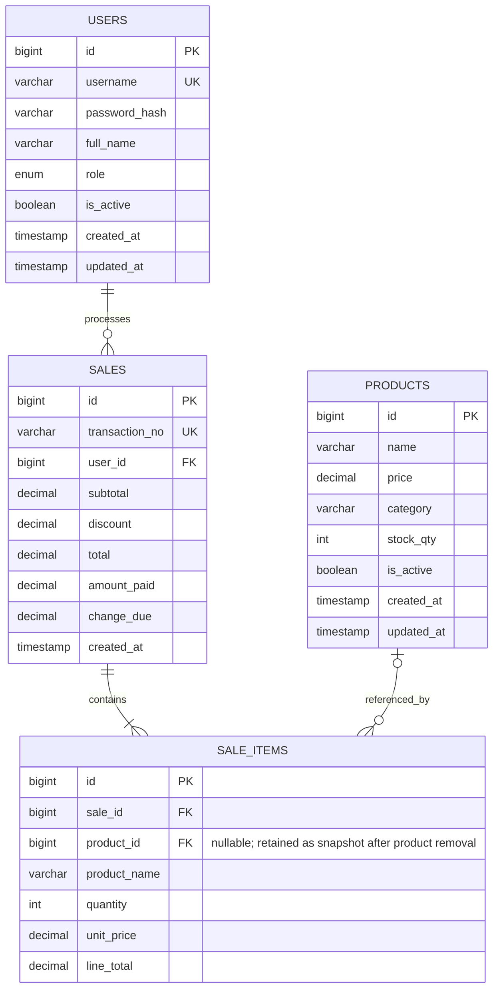

# J&K MDSE Store (999) POS — ERD

`sale_items` retains the product name and price as sold, so printed receipts remain accurate if the product is later edited. Deleting a catalog item is implemented as a soft delete; if it is physically removed from the database, its historical item reference becomes null.
